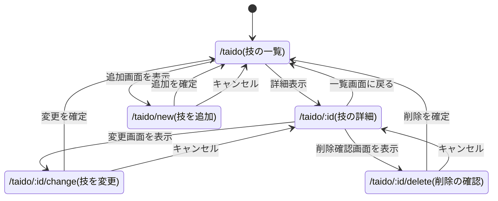

1. 躰道の技一覧
2. 千葉工業大学の施設（新習志野と津田沼に分ける）を一覧表示するシステム
3. 仮面ライダーシリーズの時系列的な一覧表
------
採用候補.   
4. マーベルヒーローシステム.   
5. 情報漏洩企業システム.  

本レポートでは，以下の3つのシステムを作成するにあたり，実装予定の機能，データのスキーム，ページ遷移を記述する．

- 躰道技一覧表示システム
- 千葉工業大学施設表示システム
- 仮面ライダーシリーズ年表システム

現段階では，躰道技一覧表示システムのみを設計する．残り2つのシステムは，データのスキームを用意してから設計する．

# 躰道技一覧表示システム

躰道の技の種類や名前，練習時に意識することを記録し，一覧画面や詳細画面で確認できるシステムを作成する．

## 実装する予定の機能

- 登録されている躰道の技を一覧表示する．
- 選択した技の種類，名前，練習時に意識することを詳細表示する．
- 未登録の技を追加する．
- 誤って登録した架空の技などを削除する．
- 技の名前など，登録内容に誤りがある場合は変更する．

## スキーム

| 項目名 | 型 | 内容 |
| ------ | ------ | ------ |
| id | 数値 | 技ID |
| type | 文字列 | 技の種類（旋・運・変・捻・転） |
| name | 文字列 | 技の名前 |
| notes | 文字列 | 練習時に意識すること |

## ページ遷移

一覧画面から技を選択して詳細画面へ移動し，詳細画面からその技の変更画面または削除確認画面へ移動する．追加・変更・削除の確定後は一覧画面へ戻る．キャンセル時は，追加画面からは一覧画面へ，変更画面と削除確認画面からは詳細画面へ戻る．

