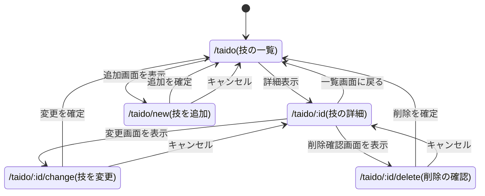
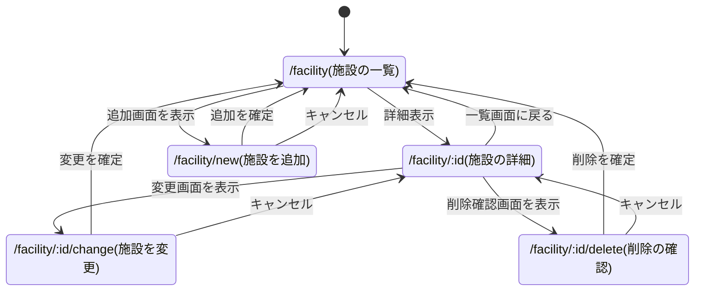
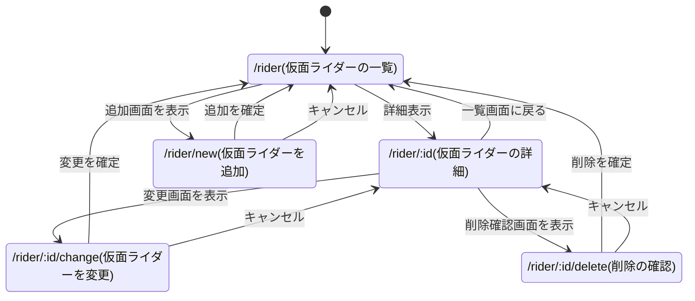

1. 躰道の技一覧
2. 千葉工業大学の施設（新習志野と津田沼に分ける）を一覧表示するシステム
3. 仮面ライダーシリーズの時系列的な一覧表
------
採用候補.   
4. マーベルヒーローシステム.   
5. 情報漏洩企業システム.  

本レポートでは，以下の3つのシステムを作成するにあたり，実装予定の機能，データのスキーム，ページ遷移を記述する．

- 躰道技一覧表示システム
- 千葉工業大学施設一覧表示システム
- 仮面ライダーシステム

以下に，3つのシステムの仕様を示す．

# 躰道技一覧表示システム

躰道の技の種類や名前，練習時に意識することを記録し，一覧画面や詳細画面で確認できるシステムを作成する．

## 実装する予定の機能

- 登録されている躰道の技を一覧表示する．
- 選択した技の種類，名前，練習時に意識することを詳細表示する．
- 未登録の技を追加する．
- 誤って登録した架空の技などを削除する．
- 技の名前など，登録内容に誤りがある場合は変更する．

## スキーム

| 項目名 | 型 | 内容 |
| ------ | ------ | ------ |
| id | 数値 | 技ID |
| type | 文字列 | 技の種類（旋・運・変・捻・転） |
| name | 文字列 | 技の名前 |
| notes | 文字列 | 練習時に意識すること |

## ページ遷移

一覧画面から技を選択して詳細画面へ移動し，詳細画面からその技の変更画面または削除確認画面へ移動する．追加・変更・削除の確定後は一覧画面へ戻る．キャンセル時は，追加画面からは一覧画面へ，変更画面と削除確認画面からは詳細画面へ戻る．

# 千葉工業大学施設一覧表示システム

千葉工業大学の施設の名前，用途，所属するキャンパスを記録し，一覧画面や詳細画面で確認できるシステムを作成する．一覧画面では，新習志野キャンパスと津田沼キャンパスに分けて施設を表示する．

## 実装する予定の機能

- 登録されている施設をキャンパスごとに分けて一覧表示する．
- 選択した施設の名前，用途，キャンパス名を詳細表示する．
- 未登録の施設を追加する．
- 誤って登録した施設の情報を削除する．
- 施設の名前など，登録内容に誤りがある場合は変更する．

## スキーム

| 項目名 | 型 | 内容 |
| ------ | ------ | ------ |
| id | 数値 | 施設ID |
| name | 文字列 | 施設の名前 |
| uses | 文字列 | 用途 |
| campus | 文字列 | キャンパス名（新習志野・津田沼） |

施設IDは，両キャンパスを通して重複しない値とする．

## ページ遷移

一覧画面から施設を選択して詳細画面へ移動し，詳細画面からその施設の変更画面または削除確認画面へ移動する．追加・変更・削除の確定後は一覧画面へ戻る．キャンセル時は，追加画面からは一覧画面へ，変更画面と削除確認画面からは詳細画面へ戻る．

# 仮面ライダーシステム

仮面ライダーの放送年，名前，必殺技，変身者の名前を記録し，一覧画面や詳細画面で確認できるシステムを作成する．一覧画面では，放送年の昇順に表示する．

## 実装する予定の機能

- 登録されている仮面ライダーを放送年の昇順で一覧表示する．
- 選択した仮面ライダーの放送年，名前，必殺技，変身者の名前を詳細表示する．
- 未登録の仮面ライダーを追加する．
- 誤って登録した仮面ライダーの情報を削除する．
- 仮面ライダーの名前など，登録内容に誤りがある場合は変更する．

## スキーム

| 項目名 | 型 | 内容 |
| ------ | ------ | ------ |
| id | 数値 | ライダーID |
| year | 数値 | 放送年 |
| name | 文字列 | 仮面ライダーの名前 |
| special move | 文字列 | 必殺技 |
| user_name | 文字列 | 変身者の名前 |

## ページ遷移

一覧画面から仮面ライダーを選択して詳細画面へ移動し，詳細画面からその仮面ライダーの変更画面または削除確認画面へ移動する．追加・変更・削除の確定後は一覧画面へ戻る．キャンセル時は，追加画面からは一覧画面へ，変更画面と削除確認画面からは詳細画面へ戻る．

